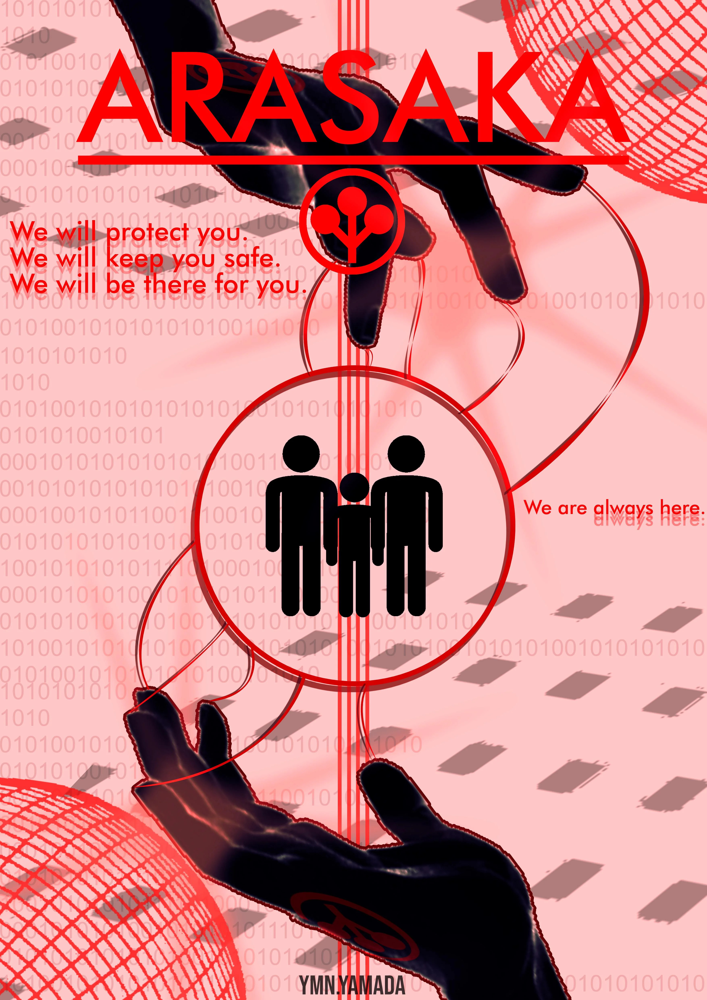

# ARASAKA SUBNET

**ARASAKA // restricted network // recovered gig briefing**

The operator account ID is in your hands, but its four-digit PIN is not. Arasaka's subnet is
leaking public files, a Board dispatch, and a remote maintenance channel. Recover five flags
and find out where the corporation took Alt Cunningham.

**Estimated difficulty:** medium  
**Flags:** 5, format `FLAG{...}`  
**Web image:** `ghcr.io/your-username/arquivo-fantasma:1.0`  
**SSH image:** `ghcr.io/your-username/arquivo-fantasma-ssh:1.0`  
**Distribution Compose:** [docker-compose.distribution.yml](./docker-compose.distribution.yml)

After replacing `your-username` with the published namespace, start it with:
`docker compose -f docker-compose.distribution.yml up -d`.

_Arasaka records every access. Jack in, choom._
